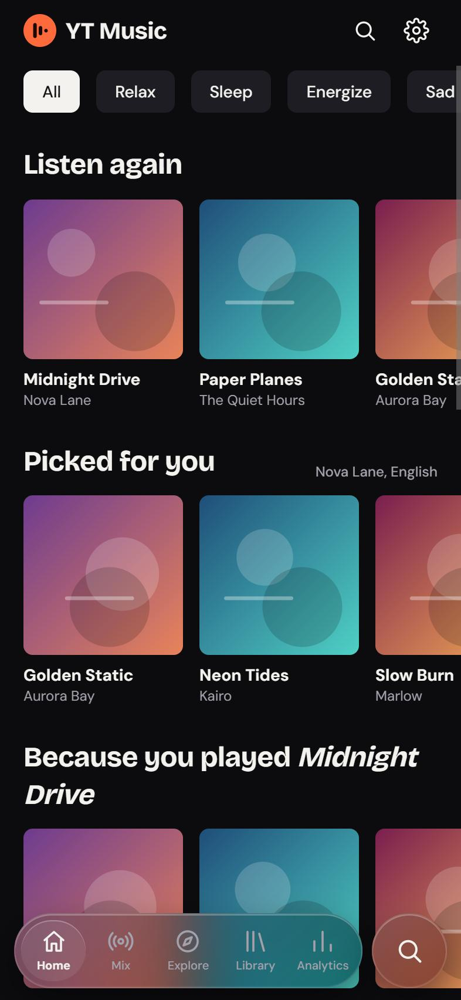
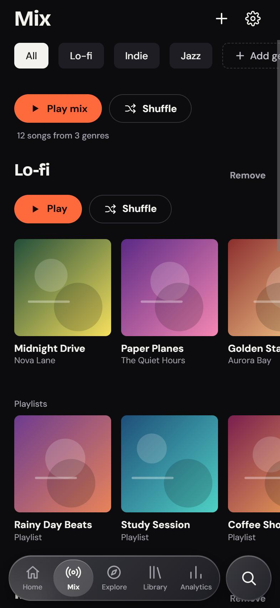
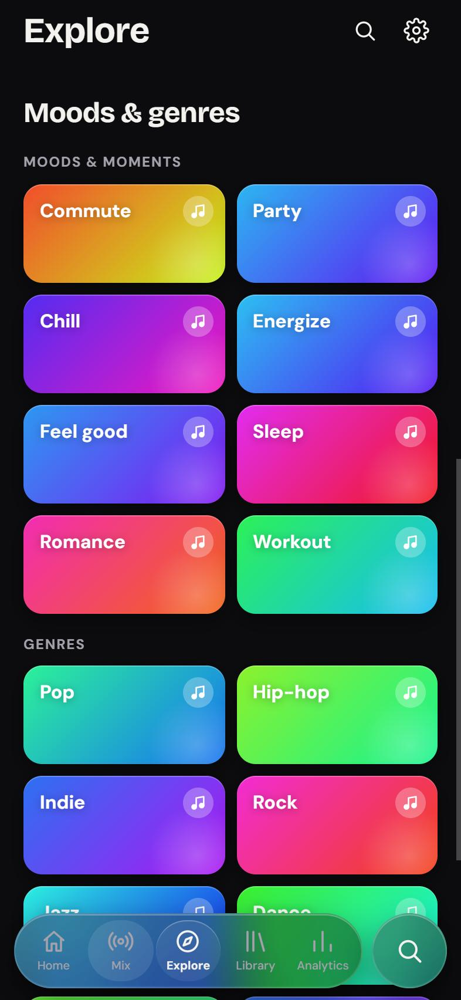
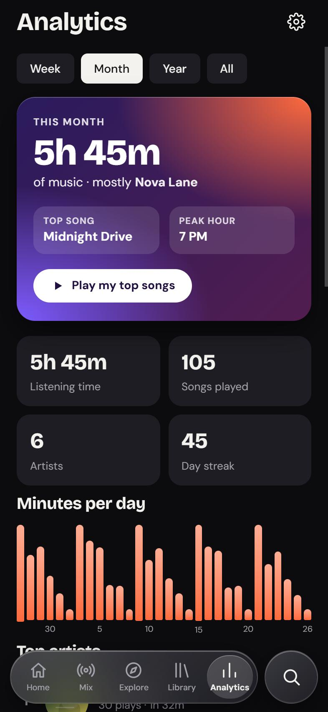
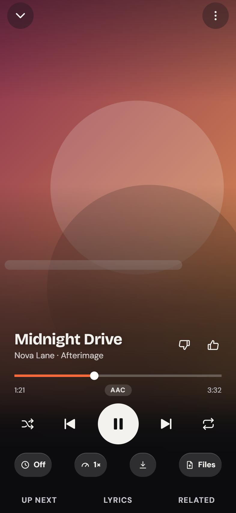
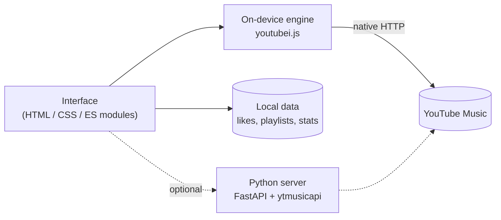

<div align="center">


# YT Music

**A fast, private, ad-free YouTube Music player for your iPhone.**<br>
Built as a native app that talks to YouTube Music straight from the phone. No server, no subscription, no PC needed.


[Features](#features) · [Screenshots](#screenshots) · [How it works](#how-it-works) · [Get the app](#get-the-app) · [Project layout](#project-layout)

</div>

<br>

## Screenshots

<table>
  <tr>
    <td align="center"><br><sub><b>Home</b><br>mood chips, listen again, picks for you</sub></td>
    <td align="center"><br><sub><b>Mix</b><br>your own genres, found automatically</sub></td>
    <td align="center"><br><sub><b>Explore</b><br>moods &amp; genres tiles</sub></td>
    <td align="center"><br><sub><b>Analytics</b><br>your listening, on your phone</sub></td>
    <td align="center"><br><sub><b>Now Playing</b><br>blur style</sub></td>
  </tr>
</table>

<sub>Screenshots use invented songs and generated artwork.</sub>

## Features

### Listen

| | |
|---|---|
| **Ad-free, background playback** | Full-length audio streams straight from YouTube Music. Keeps playing with the screen locked, with lock-screen controls. |
| **A queue that keeps going** | Every song starts a radio that keeps extending itself. **Dynamic queue** re-ranks what comes next from what you finish, skip and like. |
| **Synced lyrics** | Time-synced lyrics from YouTube Music, with LRCLIB as a fallback for songs that have none. Tap a line to jump to it. |
| **Offline** | Save songs for offline listening, export any song to **Files** as `.m4a`, or cut a ringtone clip. |
| **Playback you control** | Auto, Stream or Download-first playback, next-song prefetch, speed, sleep timer, AirPlay, optional **SponsorBlock** skipping for music videos. |

### Discover

| | |
|---|---|
| **Home** | Mood chips (Relax, Sleep, Energize, Sad…), Listen again, Picked for you from your artists and languages, Because you played…, Quick picks, Trending. |
| **Mix** | Add any genre, mood or style (*Lo-fi*, *Tamil hip-hop*, *90s Bollywood*…). Each one is searched for songs and playlists the moment you add it, and **Play mix** blends them all into one queue. |
| **Explore** | New releases, charts (global or your country), top artists, and bold gradient **Moods &amp; genres** tiles. |
| **Global by default** | Quick picks, New releases, Trending and Charts show worldwide music. One switch makes them follow your country instead. |

### Yours

| | |
|---|---|
| **Analytics** | A Wrapped-style summary, listening time, top artists and songs, a streak, listening by day and by hour. Worked out on the device from your own play log. Nothing is uploaded. |
| **Library** | Likes, your own playlists, saved albums and artists, history, and downloads. |
| **Import** | Build a playlist from a pasted list (`Song - Artist`) or a CSV exported from another app; each line is matched on YouTube Music. |
| **Backup and restore** | One file with your likes, playlists, genres, analytics and settings. Restore it after reinstalling or on a new phone. |

### Look and feel

- Two switchable styles: **Glass** (a floating, frosted tab bar and mini player) or **Classic**, and a **Blur** or **Classic** Now Playing screen.
- Accent colours, or an accent that follows the artwork.
- Designed for iPhone first; the same UI becomes a sidebar-and-panel layout on a desktop browser.

## How it works



- **The app** is a [Capacitor](https://capacitorjs.com) wrapper around a plain web UI (`frontend/`, no build step). It plays audio from a direct, device-bound stream address.
- **The engine** (`frontend/js/engine`) answers the same endpoints as the optional server (search, home, charts, moods, albums, artists, playlists, radio, lyrics, streams), using the [`youtubei.js`](https://github.com/LuanRT/YouTube.js) client. Inside the app it uses Capacitor's native HTTP with a fresh connection per request.
- **Everything personal stays on the phone**: likes, playlists, history, analytics and settings live in local storage and IndexedDB.
- **The optional server** (`backend/`, FastAPI with `ytmusicapi` and `yt-dlp`) powers the website version and ringtone cutting. The app works without it.

## Get the app

There is no Mac involved. A cloud Mac builds the app, and you sign it on your iPhone with your own certificate.

**Quickest:** download `YTMusic-unsigned.ipa` from the [latest release](../../releases/latest) and sign it on your iPhone. Or build it yourself:

1. **Fork or push this repo to your own GitHub account** (private is fine).
2. Open **Actions → Build iOS app → Run workflow**. In about a minute it produces the artifact **`YTMusic-unsigned.ipa`**.
3. Download it, move it to your iPhone, and install it with the signing tool you use for your own apps. Then trust the developer under *Settings → General → VPN &amp; Device Management*.

No signing secrets are needed in GitHub. If you would rather have the cloud build sign the IPA for you, see [`ios-app/README.md`](ios-app/README.md) for the three optional secrets.

> Apps signed with third-party or enterprise certificates can be revoked by whoever issued the certificate. If the app stops opening, build it again and sign with a fresh one. **Settings → Privacy → Back up and restore** keeps your data safe in the meantime.

## Troubleshooting

Under **Settings → About** the app has two tools for the rare case that songs stop starting or only play for a minute:

- **Connection check** shows the phone's network addresses and, for each YouTube client, whether it can fetch audio.
- **Reset connection** clears saved cookies and starts a fresh YouTube session.

## Project layout

```text
frontend/             the app UI (plain ES modules, no build step)
  js/
    app.js            boot, click routing, native bootstrap
    views.js          Home, Explore, Search, Library, Settings
    mix.js            Mix tab (custom genres)
    stats.js          Analytics tab
    now.js            mini player and Now Playing
    player.js         playback, queue, dynamic queue, SponsorBlock
    sheets.js         menus, playlists, Save to Files, ringtones
    backup.js         backup / restore and playlist import
    store.js          likes, playlists, stats, downloads (local data)
    settings.js       preferences
    engine/           the on-device YouTube Music engine
  vendor/             youtubei.js (MIT)
ios-app/              Capacitor project config and build scripts
.github/workflows/    the cloud build for the iOS app
backend/              optional FastAPI server (website version, ringtone clips)
docs/screenshots/     images used in this README
```

<details>
<summary><b>Optional server API</b></summary>

The server and the on-device engine expose the same endpoints.

| Endpoint | Purpose |
|---|---|
| `GET /api/search?q=&filter=songs\|videos` | search |
| `GET /api/suggest?q=` | search suggestions |
| `GET /api/radio/{videoId}` | "up next" recommendations for a song |
| `GET /api/home` | quick picks |
| `GET /api/trending?country=ZZ` | first chart playlist as tracks |
| `GET /api/explore` | new releases and mood / genre categories |
| `GET /api/charts?country=ZZ` | chart playlists and top artists |
| `GET /api/mood?params=` | playlists for a mood or genre |
| `GET /api/genre?q=` | songs and playlists for a genre name (Mix tab) |
| `GET /api/album/{id}`, `/api/playlist/{id}`, `/api/artist/{id}` | detail pages |
| `GET /api/mix?artists=&langs=` | songs from picked artists and languages |
| `GET /api/lyrics/{videoId}` | lyrics, time-synced when available |
| `GET /api/ringtone/{videoId}?start=&dur=` | AAC clip for ringtones |
| `GET /stream/{videoId}?q=high\|low` | audio proxy with HTTP Range support |

Catalogue endpoints accept `loc=XX` (country). Set `APP_TOKEN` to require `?token=` or an `X-Token` header on every call.

</details>

## Tech

Capacitor 8 · vanilla ES modules · an `<audio>` element with Media Session · `youtubei.js` · IndexedDB and local storage · FastAPI, `ytmusicapi`, `yt-dlp` (optional server) · GitHub Actions on a macOS runner.

## Notes

- **Personal and educational use only.** This project is not affiliated with or endorsed by YouTube or Google. It relies on unofficial interfaces, which can break or be restricted at any time, and using it may be against YouTube's terms. You are responsible for how you use it. When something breaks, the fix is usually a small update to the engine.
- Keep any server you run private (for example behind Tailscale) and protect it with `APP_TOKEN`.
- Bump `VERSION` in `frontend/sw.js` when you change cached files and want the website version to refresh immediately.

## License

[MIT](LICENSE). The bundled `youtubei.js` is MIT too (see `frontend/vendor/youtubei.LICENSE.txt`).

## Acknowledgements

Inspired by [SimpMusic](https://github.com/maxrave-dev/SimpMusic). Built with [youtubei.js](https://github.com/LuanRT/YouTube.js), [ytmusicapi](https://github.com/sigma67/ytmusicapi), [yt-dlp](https://github.com/yt-dlp/yt-dlp), [Capacitor](https://capacitorjs.com), [LRCLIB](https://lrclib.net) for fallback lyrics, and [SponsorBlock](https://sponsor.ajay.app) for the optional skip feature.
