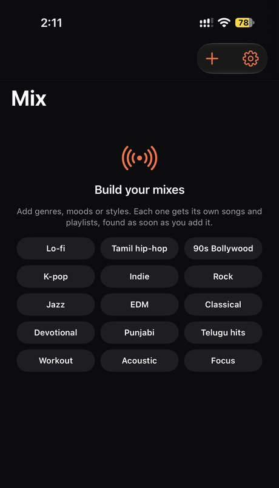
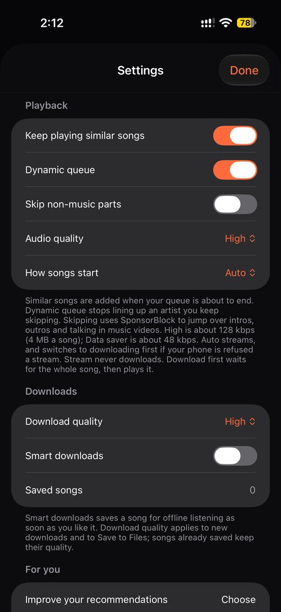
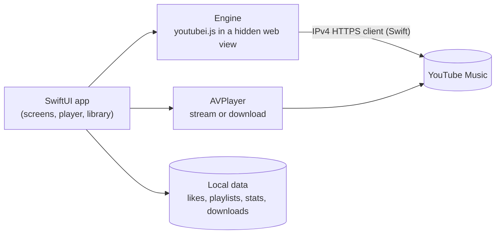
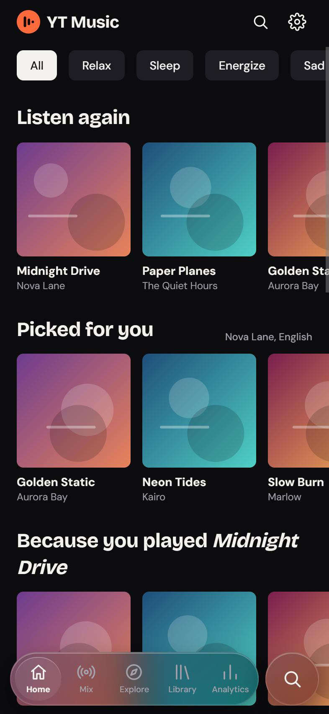
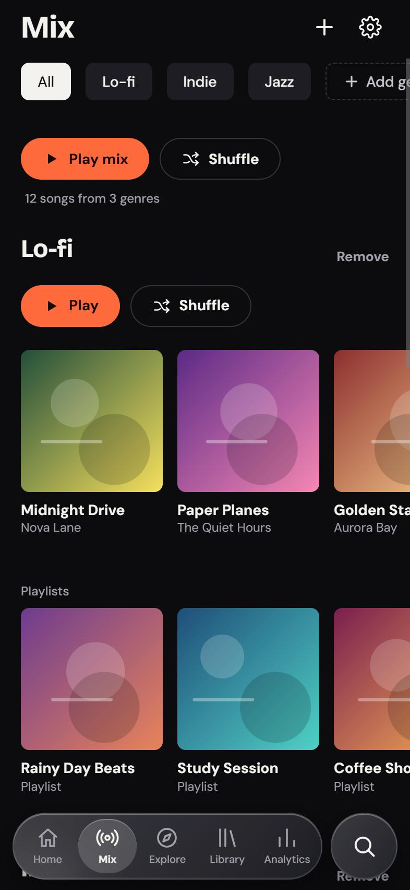
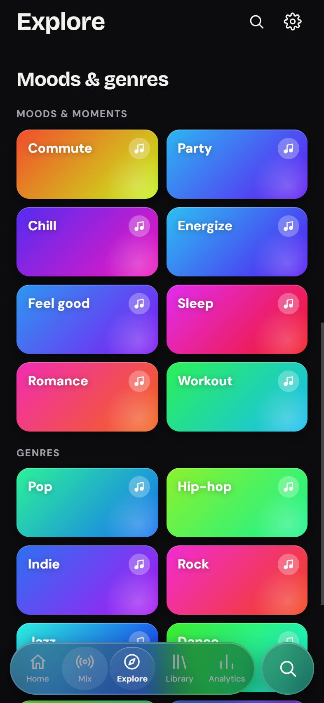
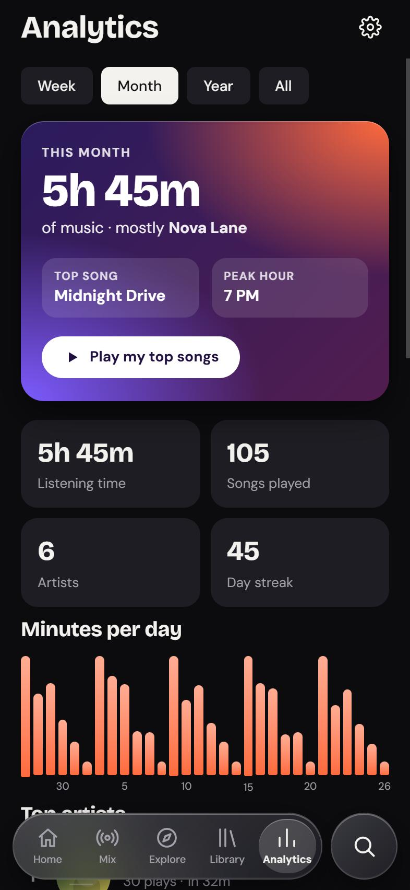
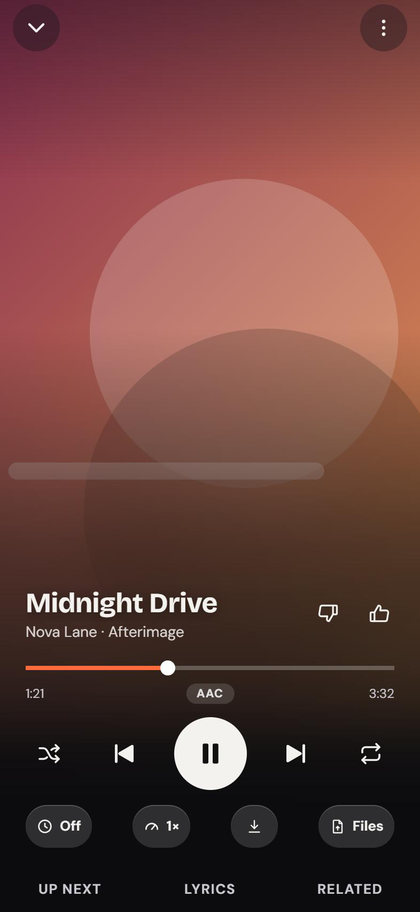

<div align="center">


# YT Music

**A fast, private, ad-free YouTube Music player for your iPhone.**<br>
A native SwiftUI app that talks to YouTube Music straight from the phone. No server, no subscription, no PC needed.


[Screenshots](#screenshots) · [Features](#features) · [How it works](#how-it-works) · [Get the app](#get-the-app) · [Web version](#web-version-and-optional-server) · [Project layout](#project-layout)

</div>

<br>

## Screenshots

<table>
  <tr>
    <td align="center"><br><sub><b>Mix</b><br>your own genres and moods</sub></td>
    <td align="center"><br><sub><b>Settings</b><br>playback, downloads, accent colour</sub></td>
  </tr>
</table>

## Features

### Listen

| | |
|---|---|
| **Ad-free, background playback** | Full-length audio streams straight from YouTube Music. Keeps playing with the screen locked, with lock-screen controls and the cover on the lock screen. |
| **Stations and a queue that keeps going** | Start a radio from any song, or just play: when the queue runs low, similar songs are added. **Dynamic queue** also draws on songs you like, and stops lining up an artist you keep skipping. Shuffle, repeat, and "not interested". |
| **Synced lyrics** | Time-synced lyrics from YouTube Music, with LRCLIB as a fallback for songs that have none. Tap a line to jump to it. |
| **Offline** | Save songs for offline listening (or turn on **Smart downloads** to save every song you like), and export any song to **Files** as `.m4a` with title, artist, album and cover written in. |
| **Playback you control** | Auto, Stream or Download-first start modes with next-song prefetch, audio quality, speed, sleep timer, AirPlay, and optional **SponsorBlock** skipping for music videos. |

### Discover

| | |
|---|---|
| **Home** | Mood chips, Listen again, Picked for you from your artists and languages, Because you played…, Quick picks, Trending, and your own YouTube Music home when you sign in. Every section can be hidden. |
| **Mix** | Add any genre, mood or style (*Lo-fi*, *Tamil hip-hop*, *90s Bollywood*…). Each one is searched for songs and playlists the moment you add it, and **Play mix** blends them all into one queue. |
| **Explore** | New releases, charts (global or your country), top artists, and **Moods & genres** tiles, with album, playlist and artist pages. |
| **Song versions** | Music videos play as their *song* version (clean audio, album art), like YouTube Music does. |
| **Global by default** | Quick picks, New releases, Trending and Charts show worldwide music. One switch makes them follow your country instead. |

### Yours

| | |
|---|---|
| **Library** | Likes, your own playlists (rename, remove songs), saved albums and followed artists, history, and downloads. |
| **Analytics** | A Wrapped-style summary you can share, listening time, top artists and songs, a streak, listening by day and by hour of the day. Worked out on the phone from your own play log. Nothing is uploaded. |
| **Account (optional)** | Sign in with Google's TV device-code flow (you approve a short code at google.com/device; the app never sees your password) to show your YouTube Music home and liked songs. Experimental. |
| **Search a list** | Paste several songs (or a CSV from another app), check the best match for each line, then play them all, queue them, or save them as a playlist. |
| **Backup** | One file with your likes, playlists, saved items, genres, analytics and settings, in a format the web version understands too. |

### Look and feel

- **Dark, light or automatic** theme, eight accent colours, any custom colour, or an accent that follows the cover art.
- Swipe a song right to like it and left to play it next. Swipe the mini player for next and previous.
- Smooth, native scrolling and menus.

## How it works



- **The app** is written in SwiftUI. It plays audio with `AVPlayer`, from a direct, device-bound stream address.
- **The engine** is the same JavaScript used by the web version (`frontend/js/engine`, built on [`youtubei.js`](https://github.com/LuanRT/YouTube.js)). The app runs it in a hidden web view and asks it for search results, charts, lyrics and stream addresses. Its network requests go back to Swift, which uses its own **IPv4-only HTTPS client** (a new connection per request, no cookies, no cache), because YouTube treats IPv4 and IPv6 connections very differently.
- **Everything personal stays on the phone**: likes, playlists, history, analytics and downloads live in the app's private storage.

## Get the app

There is no Mac involved. A cloud Mac builds the app, and you sign it on your iPhone with your own certificate.

**Quickest:** download `YTMusic-unsigned.ipa` from the [latest release](../../releases/latest). Or build it yourself:

1. **Fork or push this repo to your own GitHub account** (private is fine).
2. Open **Actions → Build iOS app → Run workflow**. In a few minutes it produces the artifact **`YTMusic-unsigned.ipa`**.
3. Download it, move it to your iPhone, and either install it with the signing tool you use for your own apps, or import it into [LiveContainer](https://github.com/LiveContainer/LiveContainer) (no signing step, and the app doesn't count toward the 3-app limit). If you sign it yourself, trust the developer under *Settings → General → VPN & Device Management*.

No secrets are needed in GitHub. To update, install the new IPA over the old one: your data is kept.

> Apps signed with third-party or enterprise certificates can be revoked by whoever issued the certificate. If the app stops opening, install it again with a fresh one. **Library → ··· → Back up to a file** keeps your data safe in the meantime.

**Coming from the earlier web-wrapper version?** In that app use *Settings → Privacy → Back up and restore → Back up to a file*, then in the new app open *Library → ··· → Import web app backup*.

## Troubleshooting

Under **Settings → About** the app has two tools for the rare case that songs stop starting or only play for a minute:

- **Connection check** shows the phone's network addresses and, for each YouTube client, whether it can fetch audio.
- **Reset connection** clears saved cookies and starts a fresh YouTube session.

## Web version and optional server

The same app also exists as a website (installable as a PWA) in `frontend/`, plain ES modules with no build step, and runs the same engine in the browser through an optional Python server in `backend/` (FastAPI with `ytmusicapi` and `yt-dlp`). The server is only needed for the website version and for cutting ringtone clips; the iPhone app works without it.

<table>
  <tr>
    <td align="center"><br><sub><b>Home</b></sub></td>
    <td align="center"><br><sub><b>Mix</b></sub></td>
    <td align="center"><br><sub><b>Explore</b></sub></td>
    <td align="center"><br><sub><b>Analytics</b></sub></td>
    <td align="center"><br><sub><b>Now Playing</b></sub></td>
  </tr>
</table>

<sub>The website version, with invented songs and generated artwork.</sub>

## Project layout

```text
ios/                  the iPhone app (SwiftUI)
  Sources/            screens, player, library, engine bridge
  Engine/             host page for the engine (the engine files are copied in at build time)
  scripts/            copy-engine.sh
  project.yml         XcodeGen project description
frontend/             the website version and the engine
  js/engine/          the YouTube Music engine (shared with the iPhone app)
  vendor/             youtubei.js (MIT)
backend/              optional FastAPI server (website version, ringtone clips)
.github/workflows/    the cloud build for the iPhone app
docs/screenshots/     images used in this README
```

<details>
<summary><b>Optional server API</b></summary>

The server and the on-device engine expose the same endpoints.

| Endpoint | Purpose |
|---|---|
| `GET /api/search?q=&filter=songs\|videos` | search |
| `GET /api/suggest?q=` | search suggestions |
| `GET /api/radio/{videoId}` | "up next" recommendations for a song |
| `GET /api/home` | quick picks |
| `GET /api/trending?country=ZZ` | first chart playlist as tracks |
| `GET /api/explore` | new releases and mood / genre categories |
| `GET /api/charts?country=ZZ` | chart playlists and top artists |
| `GET /api/mood?params=` | playlists for a mood or genre |
| `GET /api/genre?q=` | songs and playlists for a genre name (Mix tab) |
| `GET /api/album/{id}`, `/api/playlist/{id}`, `/api/artist/{id}` | detail pages |
| `GET /api/mix?artists=&langs=` | songs from picked artists and languages |
| `GET /api/lyrics/{videoId}` | lyrics, time-synced when available |
| `GET /api/ringtone/{videoId}?start=&dur=` | AAC clip for ringtones |
| `GET /stream/{videoId}?q=high\|low` | audio proxy with HTTP Range support |

Catalogue endpoints accept `loc=XX` (country). Set `APP_TOKEN` to require `?token=` or an `X-Token` header on every call.

</details>

## Tech

SwiftUI · AVPlayer · `youtubei.js` (run in WKWebView) · Network.framework · XcodeGen · GitHub Actions on a macOS runner. Website and server: vanilla ES modules, FastAPI, `ytmusicapi`, `yt-dlp` (optional).

## Notes

- **Personal and educational use only.** This project is not affiliated with or endorsed by YouTube or Google. It relies on unofficial interfaces, which can break or be restricted at any time, and using it may be against YouTube's terms. You are responsible for how you use it. When something breaks, the fix is usually a small update to the engine.
- Keep any server you run private (for example behind Tailscale) and protect it with `APP_TOKEN`.

## License

[MIT](LICENSE). The bundled `youtubei.js` is MIT too (see `frontend/vendor/youtubei.LICENSE.txt`).

## Acknowledgements

Inspired by [SimpMusic](https://github.com/maxrave-dev/SimpMusic). Built with [youtubei.js](https://github.com/LuanRT/YouTube.js), [ytmusicapi](https://github.com/sigma67/ytmusicapi), [yt-dlp](https://github.com/yt-dlp/yt-dlp), [XcodeGen](https://github.com/yonaskolb/XcodeGen), [LRCLIB](https://lrclib.net) for fallback lyrics, and [SponsorBlock](https://sponsor.ajay.app) for the optional skip feature.
